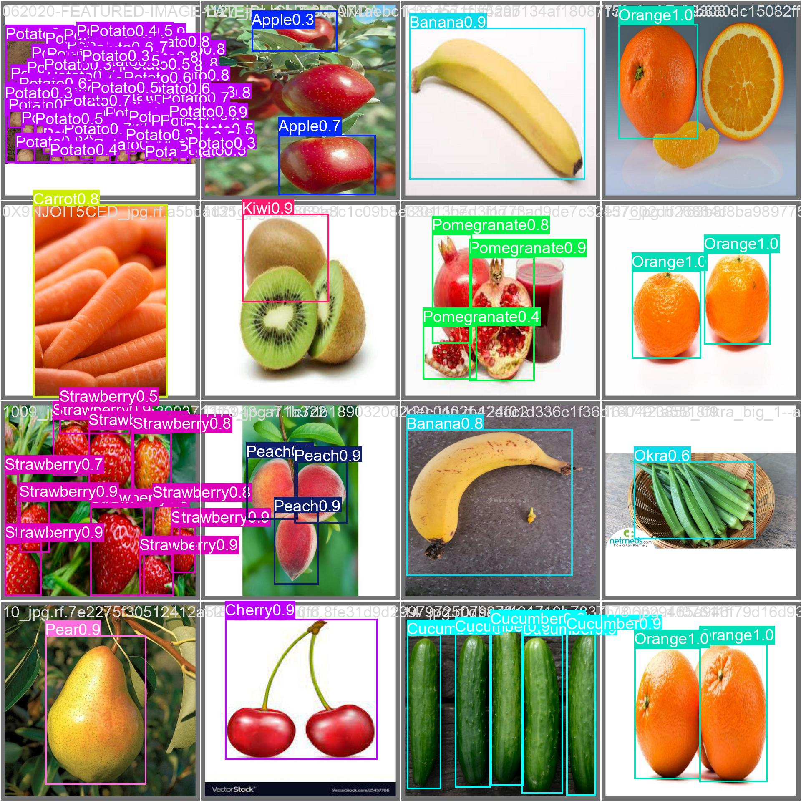

# 🥑 Smart Pantry Web Showcase & Mobile APK Download Portal

An industry-standard, production-grade landing page and documentation portal for the **Smart Pantry** on-device edge AI system.



---

## 🌟 Key Features

1. **Live Interactive YOLO Produce Detector (HUD Playground)**:
   - Real-time produce bounding box rendering and confidence scoring.
   - Dynamic threshold tuning: Confidence filter (`conf_thresh`) and Class-Aware NMS (`iou_thresh`).
   - Aspect-preserving rectangular letterbox vs. naive 640×640 stretch comparison (demonstrates why naive ports distort 37 gray levels).
   - Interactive **Review HUD** with Tap-to-Correct active learning simulation.
   - Shelf-life calculation (Room vs. Refrigerator) and macro/calorie estimators.

2. **YOLOv8m 50-Epoch Benchmark Showcase**:
   - Grounded in authentic Ultralytics training logs: **92.08% mAP@50**, **92.37% precision**, **83.22% recall**, **79 GFLOPs**.
   - Interactive zoomable gallery: Validation prediction batches, normalized confusion matrix, Precision-Recall & F1 curves, loss convergence plots.
   - Searchable directory of all **35 produce categories** (Apples, Tomatoes, Okra, Melons, Kiwis, etc.).

3. **Hybrid Edge-Cloud Architecture**:
   - Visual data pipeline diagram: Phone Camera → Rect-Letterbox (÷255) → Bundled detector.onnx → Post-process NMS → Review HUD → Local Pantry → FastAPI → MongoDB.
   - Interactive Swagger API Contract explorer for `/inventory/sync`, `/copilot/recipe-suggest`, `/telemetry/scan-corrections`, and `/models/latest-manifest`.

4. **Direct Mobile APK Download Portal**:
   - One-click download for `smart-pantry-v1.0.apk` with celebratory visual effects.
   - Generated high-contrast SVG QR code so users browsing on desktop can scan with mobile camera to sideload directly.
   - 3-step sideloading walkthrough (Chrome prompt override, unknown sources setting, camera permission grant).

5. **Engineering Documentation & Self-Test Guide**:
   - Quickstart setup for Docker backend and Expo mobile native build.
   - Deep dive into the 37 gray-level stretch bug and OpenCV aspect-preserving parity.
   - In-app 30-second mobile self-test verification instructions.

---

## 🚀 Quickstart

### 1. Run Locally
```bash
cd web
npm install
npm run dev
```
Open [http://localhost:3000](http://localhost:3000) in your browser.

### 2. Build for Production
```bash
npm run build
```
The optimized production bundle is generated in `web/dist/`.

---

## 📱 How to Attach Your Real APK for Deployment

When you build your production APK using:
```bash
cd mobile
npx expo run:android --variant release
# or EAS build:
# eas build -p android --profile production --local
```

Simply copy the resulting `.apk` file into:
```bash
cp /path/to/your/app-release.apk web/public/downloads/smart-pantry-v1.0.apk
```

Then rebuild and deploy the web app:
```bash
cd web
npm run build
```
When you deploy `web/dist/` to any hosting provider (Vercel, Netlify, Firebase, GitHub Pages, or AWS S3), the download button and mobile QR code will immediately deliver your exact production APK!

---

## 🌐 1-Click Deployment Options

### Vercel
```bash
npm i -g vercel
vercel
```

### Netlify
```bash
npm i -g netlify-cli
netlify deploy --prod --dir=dist
```

### Firebase Hosting
```bash
firebase init hosting
# Set public directory to web/dist
firebase deploy --only hosting
```

